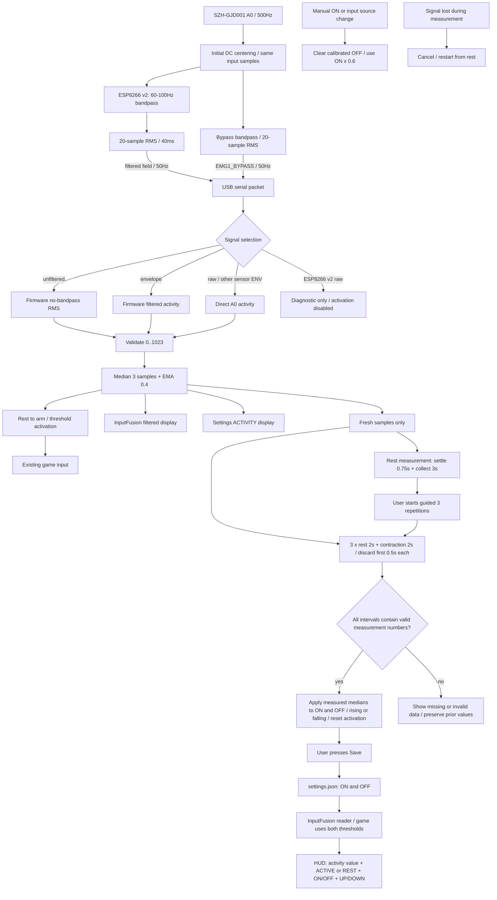

# EXTRACTED: EMG activity filtering and automatic calibration

EXTRACTED: HUD source `app/ui/game_widget.py` displays the actual activity number, ACTIVE/REST and unchanged ON/OFF; it no longer presents activity divided by ON as MVC percent.

EXTRACTED: Sources: `firmware/esp8266_emg/szh_gjd001_filter.h`, `firmware/esp8266_emg/esp8266_emg.ino`, `app/input/emg_processing.py`, `app/input/emg_reader.py`, `app/input/input_fusion.py`, `app/ui/settings_screen.py`. See [usage and limits](../docs/emg-auto-calibration.md) and [SZH-GJD001 firmware](../docs/szh-gjd001-filter.md). The diagram describes the new firmware source; flashing the hardware is a separate step.
