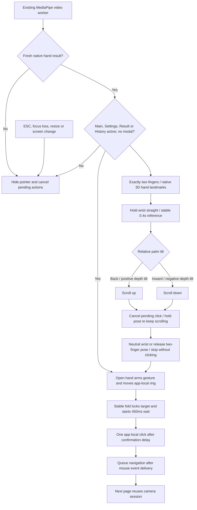

# Hand cursor flow

EXTRACTED: No OS cursor movement or global input injection. Gameplay and calibration are excluded.

EXTRACTED: Uses a camera-relative 3D palm tilt proxy, not an anatomical wrist angle with a tracked forearm. Palm faces camera and forearm stays still. Source: `app/input/hand_gestures.py`, `app/input/mediapipe_tracker.py`, `app/ui/hand_cursor.py`.
