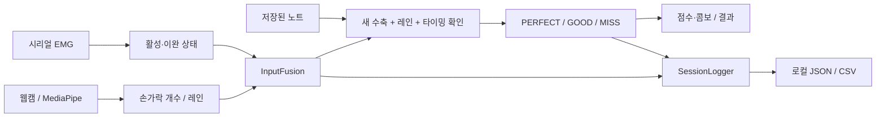

# 발표용 핵심 입력 흐름

EXTRACTED: README, `app/input/input_fusion.py`, `app/game/rhythm_game_engine.py`, `app/game/judge.py`, `app/analytics/session_logger.py`에 근거합니다. 아래 그림은 구현된 입력·판정·기록 경로의 요약이며 모든 내부 호출을 표시하지 않습니다.

VS Code의 Mermaid 지원 Markdown 미리보기 또는 Mermaid를 지원하는 저장소 뷰어에서 열어 확인합니다.
