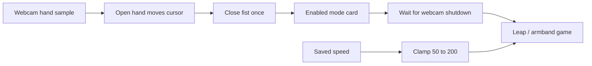

# Webcam selection and note speed — 2026.11.18.9

EXTRACTED: 게임 선택 화면에서도 웹캠 손 커서로 게임을 고를 수 있습니다. 손을 펴서 카드 위로 이동한 뒤 주먹을 한 번 쥐면 선택됩니다. 선택 처리는 기존 손 커서의 안정화·클릭 대기 시간을 따릅니다. 잠긴 상위 모드는 선택되지 않습니다.

EXTRACTED: 화면에 조작법과 카메라 상태/오류를 표시합니다. 설정에서 메뉴 손 커서를 껐다면 안내를 표시하며, 다시 켜고 저장하면 사용할 수 있습니다. 게임 시작 시 웹캠 종료를 기다리고 Leap/암밴드 입력으로 전환합니다.

EXTRACTED: 노트 속도 기본값은 200, 설정 범위는 50~200입니다. 이전 저장값도 불러오기와 저장 시 이 범위로 제한합니다. 곡의 노트 시각과 판정 창은 변경하지 않습니다.

검증: 회귀 검사 122개, 소스와 EXE 자체 진단 각각 23개 통과. `python -m unittest discover -s docs -p 'check_*.py'`. 카메라 샘플부터 실제 제스처 판독과 카드 선택까지, 이전 설정값 보정과 저장을 검사합니다. ZIP 1,323개 항목의 CRC와 번들 일치 여부를 확인했고 개인 데이터 71개 파일을 새 빌드에 보존했습니다. 물리 웹캠·센서 연결은 실제 장치에서 추가 확인해야 합니다.

Mermaid 지원 Markdown 뷰어에서 위 흐름을 확인할 수 있습니다. 구조 분석을 갱신하려면 저장소에서 `graphify .`를 실행합니다.

EXTRACTED: 이전 EXE 종료를 확인한 후 정리를 완료했습니다. 개인 데이터 74개 파일을 백업하고 최신 9와 직전 8만 남겼습니다. 실행 중인 게임을 강제 종료하지 않았습니다.
