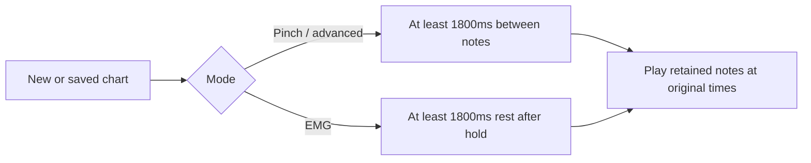

# 노트 빈도 조정 — 2026.11.18.10

EXTRACTED: 기본 핀치와 핀치+신전은 연속 노트 사이 최소 간격을 900ms에서 1800ms로 늘렸습니다. 근전도 모드는 긴 노트가 끝난 뒤 최소 1800ms 쉬도록 합니다. 노트 속도 설정과 별도로 적용되는 빈도 규칙입니다.

EXTRACTED: 새 차트 생성과 기존 차트 불러오기에 모두 적용합니다. 기존 파일은 덮어쓰지 않고 플레이할 노트를 걸러냅니다. 남긴 노트의 원래 시각을 유지하므로 박자를 이동하거나 곡 재생 시간을 늘리지 않습니다. 기본 샘플도 1900ms 간격으로 제공합니다. 직접 엔진에 전달하는 테스트용 노트는 자동으로 제거하지 않습니다.

EXTRACTED: 회귀 검사 124개 통과. 새 차트 간격, 기존 차트의 세 모드별 감소, 원본 파일 보존 및 원래 박자 유지 검사 포함. 실제 장치에서 체감 난이도는 추가 확인이 필요합니다.

EXTRACTED: 직전 빌드에 저장된 두 곡의 실제 비교: 핀치/상위 모드는 208→105개와 154→77개, 근전도는 70→35개와 63→32개입니다. 근거: `release/density-2026.11.18.10-chart-counts.json`.

EXTRACTED: 소스 및 EXE 자체 진단 각각 23개 통과. ZIP 1323개 항목의 CRC 및 파일 해시 일치를 확인했습니다. 직전 빌드의 개인 데이터 86개 파일을 새 빌드로 복사하고 원본·복사본 해시를 확인했습니다.

Mermaid 지원 Markdown 뷰어로 확인할 수 있습니다. 구조 분석 갱신: 저장소에서 `graphify .`.
