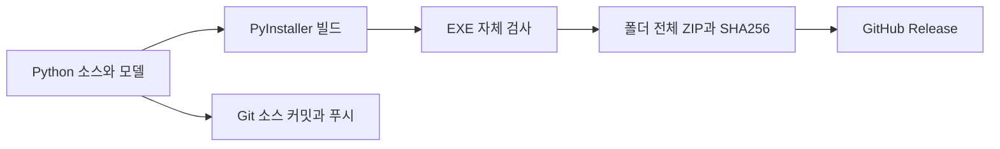

# Windows 실행 파일 배포

EXTRACTED: 현재 로컬 버전은 `2026.11.17.11`입니다. 실행 경로는 동일한 `dist_windows_current/EMG-Motion-Rhythm-No-Bandpass/EMG-Motion-Rhythm-No-Bandpass.exe`, ZIP은 `release/EMG-Motion-Rhythm-windows-x64-2026.11.17.11.zip`입니다. [정확히 두 손가락을 편 상태의 손목 기울기 스크롤](hand-cursor.md)을 사용합니다. 손목 관련 7개·EMG 관련 34개 검사, 기존 손가락/레인·손커서/결과 목록 검사와 EXE 자체 검사 11개 항목이 통과했습니다. 런타임 데이터 51개를 백업·해시 검증해 유지했고 이전 v10 ZIP/검사 파일은 정리했습니다.

EXTRACTED: 현재 로컬 버전은 `2026.11.17.10`이며 EXE는 `dist_windows_current/EMG-Motion-Rhythm-No-Bandpass/EMG-Motion-Rhythm-No-Bandpass.exe`, ZIP은 `release/EMG-Motion-Rhythm-windows-x64-2026.11.17.10.zip`입니다. [두 손가락 드래그 스크롤](hand-cursor.md)과 [구버전 정리·데이터 백업](version-cleanup.md)을 반영했습니다. 구버전 실행 폴더·ZIP은 정리했으므로 아래 버전별 경로는 과거 생성 이력입니다. EMG 핵심 소스와 저장값을 보존하고 검증했습니다.

EXTRACTED: `2026.11.17.9`는 [EMG 게임 표시 수정](emg-game-display.md) 버전입니다. 현재 값/ON 비율을 MVC 백분율로 표시하던 부분을 제거하고 실제 활동값·활성 상태·ON/OFF·방향을 표시합니다. EXE는 `dist_windows_emg_display/EMG-Motion-Rhythm-No-Bandpass/EMG-Motion-Rhythm-No-Bandpass.exe`, ZIP은 `release/EMG-Motion-Rhythm-EMG-Display-windows-x64-2026.11.17.9.zip`입니다. 회귀 검사 34개와 EXE 자체 검사 11개 항목을 통과했습니다. 보정 계산·저장값·판정·펌웨어는 변경하지 않습니다.

EXTRACTED: `2026.11.17.8`은 [측정값 직접 보정](emg-direct-calibration.md) 버전입니다. 신호 품질 승인/거부 조건을 제거하고 측정값이 감소하는 수축도 ON/OFF 순서에 맞춰 동작합니다. EXE는 `dist_windows_direct_calibration/EMG-Motion-Rhythm-No-Bandpass/EMG-Motion-Rhythm-No-Bandpass.exe`, ZIP은 `release/EMG-Motion-Rhythm-Direct-Calibration-windows-x64-2026.11.17.8.zip`입니다. 회귀 검사 33개·EXE 자체 검사 11개 항목이 통과했습니다. 펌웨어 재업로드 없이 새 앱에서 측정·Save 후 사용합니다.

EXTRACTED: `2026.11.17.7`은 [안정 잡음·3회 반복 수축 기반 보정](emg-adaptive-calibration.md)을 포함합니다. 고정 차이 5 조건을 제거하고 소수점 ON/OFF를 게임까지 보존합니다. EXE는 `dist_windows_adaptive_calibration/EMG-Motion-Rhythm-No-Bandpass/EMG-Motion-Rhythm-No-Bandpass.exe`, ZIP은 `release/EMG-Motion-Rhythm-Adaptive-Calibration-windows-x64-2026.11.17.7.zip`입니다. 회귀 검사 31개와 EXE 자체 검사 11개 항목을 통과했습니다. 보드 재업로드는 필요 없습니다. 초기 안정 약 4초 후 안내에 따라 힘빼기/수축을 3회, 약 12초 진행합니다.

EXTRACTED: `2026.11.17.6`은 [대역통과 우회 비교 전용 빌드](emg-no-bandpass-comparison.md)입니다. EXE는 `dist_windows_no_bandpass/EMG-Motion-Rhythm-No-Bandpass/EMG-Motion-Rhythm-No-Bandpass.exe`, ZIP은 `release/EMG-Motion-Rhythm-No-Bandpass-windows-x64-2026.11.17.6.zip`입니다. NO BANDPASS를 기본 선택하며 같은 앱에서 기존 필터 모드로 전환할 수 있습니다. 회귀 검사 27개·EXE 자체 검사 11개 항목, COM3 백업·업로드·두 경로 실수신을 확인했습니다. 기존 필터 버전과 ZIP은 유지합니다.

EXTRACTED: `2026.11.17.5`는 [높은 안정 신호의 보정 실패 수정](emg-calibration-hysteresis.md)을 포함합니다. 안정/수축으로 ON과 OFF를 따로 계산·저장하고 실패 시 측정값을 표시합니다. EXE는 `dist_windows_szh_v5/EMG-Motion-Rhythm/EMG-Motion-Rhythm.exe`, ZIP은 `release/EMG-Motion-Rhythm-windows-x64-2026.11.17.5.zip`입니다. 회귀 검사 24개·EXE 자체 검사 11개 항목을 통과했습니다. 펌웨어 재업로드는 필요 없으며 새 앱에서 다시 보정해야 합니다.

EXTRACTED: `2026.11.17.4`는 [SZH-GJD001 전용 펌웨어 v2 인식과 보정 안내](szh-gjd001-filter.md)를 포함합니다. 새 EXE는 `dist_windows_szh_v4/EMG-Motion-Rhythm/EMG-Motion-Rhythm.exe`, ZIP은 `release/EMG-Motion-Rhythm-windows-x64-2026.11.17.4.zip`입니다. EXE 자체 검사 11개 항목과 회귀 검사 20개가 통과했습니다. 사용자의 COM3 ESP8266에는 전체 플래시 백업 후 새 필터 펌웨어를 업로드했고 v2 식별·실수신을 확인했습니다. 새 EXE에서 안정/수축 보정을 다시 진행해야 합니다.

EXTRACTED: `2026.11.17.3` 로컬 빌드는 [EMG 활동 신호 필터·설정 화면 자동 임계값 보정](emg-auto-calibration.md)을 포함합니다. 배포 파일은 `release/EMG-Motion-Rhythm-windows-x64-2026.11.17.3.zip`, 실행 파일은 `dist_windows/EMG-Motion-Rhythm/EMG-Motion-Rhythm.exe`입니다. EXE 자체 검사 11개 항목과 EMG 회귀 검사 17개 및 오프스크린 설정 보정 흐름 검사를 통과했습니다. GitHub에는 업로드하지 않았습니다. 실제 센서 반응은 별도 확인이 필요합니다.

EXTRACTED: `v2026.11.08.4`는 한글 모델 경로와 C++ 런타임 배포를 보완하고 MediaPipe 실패 원인을 카메라 테스트에 표시합니다. [다른 PC·한글 경로 문제 해결](mediapipe-portability.md)을 참고하세요.

EXTRACTED: `v2026.11.08.2` 빌드는 노트 기본 속도 360을 포함합니다. 기존 설치 폴더의 설정을 유지하면 저장된 속도가 우선하므로 필요시 설정에서 360으로 변경합니다.

EXTRACTED: `v2026.11.08.3`은 음악 목록의 90px 높이 제한을 제거하고 파형 미리보기를 압축했습니다. 곡은 한 줄로 표시하며 긴 제목과 파일 정보는 툴팁에서 확인합니다. 20곡으로 렌더링 검증한 결과 1280×720에서 7곡, 1440×900에서 14곡, 1920×1080에서 20곡을 한 화면에 표시했습니다.

EXTRACTED: `EMG-Motion-Rhythm.spec`과 `build_windows.ps1`은 Python 3.11 환경에서 Windows x64 폴더형 실행 파일을 만듭니다. Git에는 소스와 빌드 설정을 보관하고, 실행 파일 ZIP은 GitHub Releases에서 배포합니다.

## 실행

1. [GitHub Releases](https://github.com/didtjr5080/Rythm-Game/releases)에서 Windows ZIP을 받습니다.
2. 쓰기 가능한 폴더에 **전체 압축을 해제**합니다.
3. `EMG-Motion-Rhythm.exe`를 실행합니다. 옆의 `_internal` 폴더도 필요합니다.

EXTRACTED: 사용자 음원, 설정, 플레이 기록은 배포 파일에 포함하지 않습니다. 폴더형 EXE는 `_internal/app/data`에 실행 중 데이터를 저장합니다.

EXTRACTED: 설정에서 카메라 번호·캡처 해상도·1920×1080 및 1440×900 화면 해상도를 선택할 수 있습니다. 카메라 테스트에서 인식 개수와 손가락별 상태를 확인할 수 있습니다.

## 다시 빌드하기

```powershell
py -3.11 -m venv .venv311
.venv311/Scripts/python.exe -m pip install -r requirements-build.txt
powershell -ExecutionPolicy Bypass -File build_windows.ps1
```

EXTRACTED: 빌드는 `dist_windows/EMG-Motion-Rhythm`에 생성됩니다. EXE 자체 검사가 통과하면 `release/`에 ZIP, SHA256 파일, 검사 결과 JSON을 생성합니다.

EXTRACTED: `app/assets/app.png`는 사용자가 제공한 아이콘 원본입니다. `packaging/make_icon.py`가 이미지를 자르지 않고 투명도를 유지한 다중 크기 `app.ico`로 변환합니다. 빌드 스크립트는 이 과정을 자동 실행하며, 아이콘은 EXE 리소스와 프로그램 창·작업 표시줄에 적용됩니다.

```powershell
dist_windows/EMG-Motion-Rhythm/EMG-Motion-Rhythm.exe --self-test release/self-test.json
```

EXTRACTED: 자체 검사는 물리 카메라·시리얼·스피커를 사용하지 않고 MediaPipe 모델, Qt 렌더링, 오디오 디코딩, librosa 분석, 노트 생성을 확인합니다. 실제 장치에서의 정확도와 오디오 출력은 별도로 확인해야 합니다.

## 배포 흐름



AMBIGUOUS: 모든 Windows PC의 카메라·오디오 드라이버 조합을 검증하지는 않았습니다. 배포본은 서명되지 않았습니다.

EXTRACTED: 기존 구조 그래프는 이전 커밋을 기준으로 작성되었습니다. 구조 다이어그램은 `diagrams/`의 Mermaid 파일 또는 `graphify-out/graph.html`에서 볼 수 있으며, 수동 재생성 방법은 [Graphify 안내](graphify.md)를 참고하세요.
