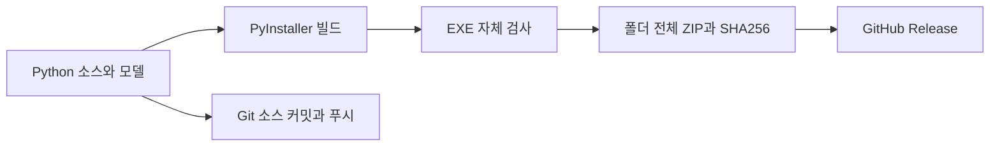

# Windows 실행 파일 배포

EXTRACTED: `EMG-Motion-Rhythm.spec`과 `build_windows.ps1`은 Python 3.11 환경에서 Windows x64 폴더형 실행 파일을 만듭니다. Git에는 소스와 빌드 설정을 보관하고, 실행 파일 ZIP은 GitHub Releases에서 배포합니다.

## 실행

1. [GitHub Releases](https://github.com/didtjr5080/Rythm-Game/releases)에서 Windows ZIP을 받습니다.
2. 쓰기 가능한 폴더에 **전체 압축을 해제**합니다.
3. `EMG-Motion-Rhythm.exe`를 실행합니다. 옆의 `_internal` 폴더도 필요합니다.

EXTRACTED: 사용자 음원, 설정, 플레이 기록은 배포 파일에 포함하지 않습니다. 폴더형 EXE는 `_internal/app/data`에 실행 중 데이터를 저장합니다.

EXTRACTED: 설정에서 카메라 번호·캡처 해상도·1920×1080 및 1440×900 화면 해상도를 선택할 수 있습니다. 카메라 테스트에서 인식 개수와 손가락별 상태를 확인할 수 있습니다.

## 다시 빌드하기

```powershell
py -3.11 -m venv .venv311
.venv311/Scripts/python.exe -m pip install -r requirements-build.txt
powershell -ExecutionPolicy Bypass -File build_windows.ps1
```

EXTRACTED: 빌드는 `dist_windows/EMG-Motion-Rhythm`에 생성됩니다. EXE 자체 검사가 통과하면 `release/`에 ZIP, SHA256 파일, 검사 결과 JSON을 생성합니다.

```powershell
dist_windows/EMG-Motion-Rhythm/EMG-Motion-Rhythm.exe --self-test release/self-test.json
```

EXTRACTED: 자체 검사는 물리 카메라·시리얼·스피커를 사용하지 않고 MediaPipe 모델, Qt 렌더링, 오디오 디코딩, librosa 분석, 노트 생성을 확인합니다. 실제 장치에서의 정확도와 오디오 출력은 별도로 확인해야 합니다.

## 배포 흐름



AMBIGUOUS: 모든 Windows PC의 카메라·오디오 드라이버 조합을 검증하지는 않았습니다. 배포본은 서명되지 않았습니다.

EXTRACTED: 기존 구조 그래프는 이전 커밋을 기준으로 작성되었습니다. 구조 다이어그램은 `diagrams/`의 Mermaid 파일 또는 `graphify-out/graph.html`에서 볼 수 있으며, 수동 재생성 방법은 [Graphify 안내](graphify.md)를 참고하세요.
