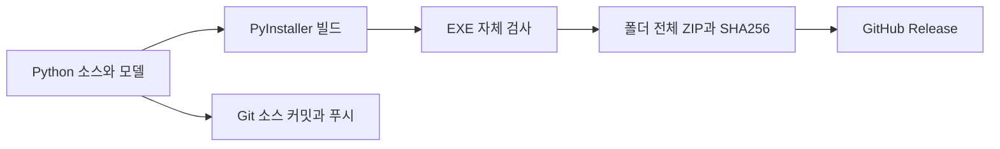

EXTRACTED: Latest 2026.11.18.10: `dist_windows_density_20261118_10/EMG-Motion-Rhythm/EMG-Motion-Rhythm.exe`, ZIP `release/EMG-Motion-Rhythm-windows-x64-2026.11.18.10.zip`. Retain 10 and previous 9. [Density changes](note-density.md). Older release paths below are historical.

EXTRACTED: Latest 2026.11.18.9: `dist_windows_camera_20261118_9/EMG-Motion-Rhythm/EMG-Motion-Rhythm.exe`; ZIP `release/EMG-Motion-Rhythm-windows-x64-2026.11.18.9.zip`. Retain 9 and previous 8. [Changes](camera-selection-speed.md). Older paths below are historical.

# Windows 실행 파일 배포

## 최신 선택 이미지 빌드: 2026.11.18.8

EXTRACTED: 핀치+암밴드 상위 카드에 사용자 첨부 PNG를 원본 그대로 적용했다. 프로필·게임 규칙은 유지한다. 실행 파일은 `dist_windows_image_20261118_8/EMG-Motion-Rhythm/EMG-Motion-Rhythm.exe`, ZIP은 `release/EMG-Motion-Rhythm-windows-x64-2026.11.18.8.zip`이다. 소스120개 검사·이미지 바이트 일치·카드 렌더링 확인. [이미지 안내](game-selection-images.md)를 참고한다. 보관 대상은 최신8과 직전7이다. 아래는 이전 기록이다.

EXTRACTED: EXE자체23항목 통과. ZIP1323파일 CRC·전체파일일치·개인데이터제외·첨부 이미지 원본일치 확인. SHA256 `55803eca6797b525e87b0c2004a58045b8dbaf3e11278b78223dc33a30e35e41`. 직전7의 프로필·설정·곡·결과71파일을 해시 검증 복사했다. 이전6과 빌드 캐시2폴더 및 ZIP/해시2파일은 사용자 데이터66항목 백업 후 삭제했다. 보고서 prefix는 `release/image-2026.11.18.8-`, 정리 백업은 `backups/build-prune-20261118-v8`이다.

## 직전 프로필 빌드: 2026.11.18.7

EXTRACTED: 실행 파일 `dist_windows_profiles_20261118_7/EMG-Motion-Rhythm/EMG-Motion-Rhythm.exe`, ZIP `release/EMG-Motion-Rhythm-windows-x64-2026.11.18.7.zip`. 사람별 보정 저장·재사용·삭제, 정상 완주 이력과 상위 모드 해금을 반영했다. [프로필 사용법](player-profiles.md)을 참고한다. 소스120개·EXE 자체23항목 통과, ZIP 무결성·전체파일일치·개인 데이터 제외 확인. SHA256 `cd8ecedb45c985bfd1fef5a3068a2897a2e321e89c35c42df1ea992f0a2f4a7e`.

EXTRACTED: 직전6의 최신 사용자 데이터64파일을 새7에 해시 검증 복사했다. 새7·직전6 폴더/ZIP만 유지하고, 구버전21폴더와 ZIP/해시36파일은 데이터490항목 백업 후 삭제했다. `backups/build-prune-20261118-v7`에 정리 계획·데이터 manifest·결과가 있다. 펌웨어·플래시·SDK 브리지·데이터 백업은 보존했다. 아래 과거 EXE 경로는 현재 파일 존재를 보장하지 않는다. 최신 검증 보고서 prefix는 `release/profiles-2026.11.18.7-`이다.

## 이전 상위 핀치 모드 빌드: 2026.11.18.6

EXTRACTED: 세 번째 '핀치+신전 상위 리듬 게임'을 추가했다. 기본 두 모드는 유지한다. Leap보정 후3.0초 최저값을 측정하며 노트 판정 순간에 Leap핀치와 유효한 암밴드 신전이 모두 있어야 득점한다. 소스104개 검사와 자체검사21항목이 통과했다. 실행 파일은 `dist_windows_advanced_20261118_6/EMG-Motion-Rhythm/EMG-Motion-Rhythm.exe`, ZIP은 `release/EMG-Motion-Rhythm-windows-x64-2026.11.18.6.zip`이다. [상위 모드 사용법](pinch-extension-mode.md)을 참고한다. 아래는 이전 빌드 기록이다.

EXTRACTED: EXE자체21항목 통과, 모드 목록 `pinch/emg/pinch_extension` 확인. ZIP1322파일 CRC·전체파일일치·개인데이터제외 통과. SHA256 `ba6087007cf81b43b0f7b3ff555712837982b17dd7d028d795eb02b4ce6dd8d6`. 이전 실행 폴더의 최신 사용자 데이터60파일은 원본 보존·해시 검증해 복사했다. 소스/EXE manifest·자체검사·ZIP/복사 보고서는 `release/advanced-2026.11.18.6-*.json`이다. 실제 동시 착용 실기는 별도다.

## 이전 근전도 기준 수정 빌드: 2026.11.18.5

EXTRACTED: 근전도 게임은 시작 전3.0초 기록의 최저값을 기준으로 현재값이 같거나 높으면 신전이다. 평균+0.01과 비교 전 반올림을 제거하고 측정값 목록을 결과에 기록한다. 연속MISS10종료·근전도 긴 노트 전용은 유지한다. 소스95개 검사·소스자체검사19항목 통과. 실행 파일은 `dist_windows_minimum_20261118_5/EMG-Motion-Rhythm/EMG-Motion-Rhythm.exe`, ZIP은 `release/EMG-Motion-Rhythm-windows-x64-2026.11.18.5.zip`이다. [근전도 현재 기준](emg-minimum-baseline.md)을 참고한다. 아래 버전은 이전 기록이다.

EXTRACTED: 메인·설정·게임의 안내를 모두 최저값 기준으로 맞춘 최종EXE 자체검사19항목 통과. 최종 보고서는 `release/minimum-2026.11.18.5-final-exe-self-test.json`이다. ZIP1322파일 CRC·전체파일 해시일치·개인데이터제외 통과, SHA256 `ffabc35ad249bcc97c0e2fa6862364f028b04c478e985b7f74197a0968fd69df`. 이전 폴더 사용자 데이터54파일은 원본 보존·해시 검증 복사했다. 소스/EXE manifest·검사·복사 보고서는 `release/minimum-2026.11.18.5-*.json`이다. 물리 장치 실기는 별도다.

## 이전 규칙 정정 빌드: 2026.11.18.4

EXTRACTED: 사용자 정정 기준은 양 모드 **연속MISS10 종료**다. PERFECT/GOOD 시 연속횟수를 초기화하며 누적MISS10만으로 종료하지 않는다. 근전도 긴 노트 전용은 유지한다. 실행 파일은 `dist_windows_rules_20261118_4/EMG-Motion-Rhythm/EMG-Motion-Rhythm.exe`, ZIP은 `release/EMG-Motion-Rhythm-windows-x64-2026.11.18.4.zip`이다. 소스92개·소스자체검사19항목이 통과했다. 자세한 규칙은 [게임 규칙](game-rule-update.md)을 참고한다.

EXTRACTED: EXE 자체 검사19항목도 통과했다. ZIP CRC·전체파일 원본일치·개인데이터제외 확인, SHA256 `5f3a8bb197819fe12094df72f330f515eb1cb9c371ac80a0e1345489a69feeb4`. 직전 실행 폴더의 사용자 데이터54파일을 원본 보존·해시 검증 후 복사했다. 소스/EXE manifest와 검사·복사 보고서는 `release/rules-2026.11.18.4-*.json`이다. 실제 물리 장치 실기는 별도다.

## 이전 규칙 수정 빌드: 2026.11.18.3 (누적 기준)

EXTRACTED: 두 모드 누적MISS10 종료와 근전도 긴 노트 전용 규칙을 적용한 실행 파일은 `dist_windows_rules_20261118_3/EMG-Motion-Rhythm/EMG-Motion-Rhythm.exe`다. 배포 ZIP은 `release/EMG-Motion-Rhythm-windows-x64-2026.11.18.3.zip`이다. 기존 음악 수정은 유지했다. 소스 검사92개가 통과했고, 소스 자체 검사도 실제MP3·양 모드 누적MISS 검사와 긴 노트 확인을 포함해 통과했다. 상세는 [현재 규칙](game-rule-update.md)을 참고한다. 아래 빌드는 이전 기록이다.

EXTRACTED: EXE 자체 검사19항목 통과. ZIP1322파일의 CRC·전체파일 해시 일치·개인데이터 제외 확인, SHA256 `c715fda993e5dc4ad1c9dbfd06675f66fdf0a6f5f7b8b9058f87c1e22912e318`. 이전 실행 폴더의 설정·곡·기록48파일은 새 폴더에 복사하고 해시 일치·원본 보존을 확인했다. 검사·복사·소스 manifest는 `release/rules-2026.11.18.3-*.json`에 있다. 실제 물리 장치와 출력 실기는 별도다.

## 이전 음악 수정 빌드: 2026.11.18.2

EXTRACTED: 실행 파일은 `dist_windows_music_20261118_2/EMG-Motion-Rhythm/EMG-Motion-Rhythm.exe`, ZIP은 `release/EMG-Motion-Rhythm-windows-x64-2026.11.18.2.zip`이다. GitHub `11c99ac`의 게임 선택 UI·Leap 전용 핀치·OYMotion 전용 근전도 구조를 유지하면서 [음악 과제](music-timeline.md)를 반영했다. 기존 실행 폴더를 덮어쓰지 않았다. 아래 버전별 최신 경로 문구는 과거 기록이다.

EXTRACTED: 기존75+새14=89개 소스 검사가 통과했다. 소스·EXE 자체 검사도 각각 19항목 통과했다. EXE는 개발용 Leap SDK 환경 변수를 해제한 상태에서 동봉 SDK 헤더·DLL을 사용했다. 실제 MP3 전체 PCM 제출·분석/재생 파형 일치, 두 모드·유지 노트·새 자연 종료 집계가 검사에 포함된다. 스피커 출력은 모의 장치이며 실제 센서 정확도·장시간 연결은 실기 TODO다.

EXTRACTED: `release/music-implementation-check.json`은 전체 곡과 실제 MP3 검사, `music-source-self-test.json`·`music-exe-self-test.json`은 자체 검사 결과다. `release/music-2026.11.18.2-manifest.json`에는 기준 Git HEAD, 미커밋 변경 포함 여부, 소스 해시와 EXE 해시를 기록했다. 이 로컬 빌드는 GitHub로 업로드하지 않았다. SHA256 없는 이전 채보는 다시 생성한다. 출력 지연 보정은 기존 방식을 유지하며 미측정 오차를 임의로 보정하지 않는다.

EXTRACTED: ZIP은 237.1MiB, 1,322파일이며 CRC·모든 파일의 원본 번들 일치·개인 데이터 제외 검사가 통과했다. Leap 헤더/DLL·OYMotion 두 DLL·게임 선택 이미지 두 개도 포함된다. ZIP SHA256은 `328f21de266b7f58fb1192f63adcecb755b6076213e896e2e5fa3fa6d5117ab1`이다. ZIP 생성 후 사용자 설정·곡·채보·기록 등 48파일을 새 로컬 실행 폴더에 복사하고 원본/사본 SHA256 일치와 원본 보존을 확인했다. `release/music-archive-check.json`과 `music-runtime-copy.json`에 기록했다.

## 이전 배포 기록

EXTRACTED: 현재 로컬 버전은 `2026.11.17.11`입니다. 실행 경로는 동일한 `dist_windows_current/EMG-Motion-Rhythm-No-Bandpass/EMG-Motion-Rhythm-No-Bandpass.exe`, ZIP은 `release/EMG-Motion-Rhythm-windows-x64-2026.11.17.11.zip`입니다. [정확히 두 손가락을 편 상태의 손목 기울기 스크롤](hand-cursor.md)을 사용합니다. 손목 관련 7개·EMG 관련 34개 검사, 기존 손가락/레인·손커서/결과 목록 검사와 EXE 자체 검사 11개 항목이 통과했습니다. 런타임 데이터 51개를 백업·해시 검증해 유지했고 이전 v10 ZIP/검사 파일은 정리했습니다.

EXTRACTED: 현재 로컬 버전은 `2026.11.17.10`이며 EXE는 `dist_windows_current/EMG-Motion-Rhythm-No-Bandpass/EMG-Motion-Rhythm-No-Bandpass.exe`, ZIP은 `release/EMG-Motion-Rhythm-windows-x64-2026.11.17.10.zip`입니다. [두 손가락 드래그 스크롤](hand-cursor.md)과 [구버전 정리·데이터 백업](version-cleanup.md)을 반영했습니다. 구버전 실행 폴더·ZIP은 정리했으므로 아래 버전별 경로는 과거 생성 이력입니다. EMG 핵심 소스와 저장값을 보존하고 검증했습니다.

EXTRACTED: `2026.11.17.9`는 [EMG 게임 표시 수정](emg-game-display.md) 버전입니다. 현재 값/ON 비율을 MVC 백분율로 표시하던 부분을 제거하고 실제 활동값·활성 상태·ON/OFF·방향을 표시합니다. EXE는 `dist_windows_emg_display/EMG-Motion-Rhythm-No-Bandpass/EMG-Motion-Rhythm-No-Bandpass.exe`, ZIP은 `release/EMG-Motion-Rhythm-EMG-Display-windows-x64-2026.11.17.9.zip`입니다. 회귀 검사 34개와 EXE 자체 검사 11개 항목을 통과했습니다. 보정 계산·저장값·판정·펌웨어는 변경하지 않습니다.

EXTRACTED: `2026.11.17.8`은 [측정값 직접 보정](emg-direct-calibration.md) 버전입니다. 신호 품질 승인/거부 조건을 제거하고 측정값이 감소하는 수축도 ON/OFF 순서에 맞춰 동작합니다. EXE는 `dist_windows_direct_calibration/EMG-Motion-Rhythm-No-Bandpass/EMG-Motion-Rhythm-No-Bandpass.exe`, ZIP은 `release/EMG-Motion-Rhythm-Direct-Calibration-windows-x64-2026.11.17.8.zip`입니다. 회귀 검사 33개·EXE 자체 검사 11개 항목이 통과했습니다. 펌웨어 재업로드 없이 새 앱에서 측정·Save 후 사용합니다.

EXTRACTED: `2026.11.17.7`은 [안정 잡음·3회 반복 수축 기반 보정](emg-adaptive-calibration.md)을 포함합니다. 고정 차이 5 조건을 제거하고 소수점 ON/OFF를 게임까지 보존합니다. EXE는 `dist_windows_adaptive_calibration/EMG-Motion-Rhythm-No-Bandpass/EMG-Motion-Rhythm-No-Bandpass.exe`, ZIP은 `release/EMG-Motion-Rhythm-Adaptive-Calibration-windows-x64-2026.11.17.7.zip`입니다. 회귀 검사 31개와 EXE 자체 검사 11개 항목을 통과했습니다. 보드 재업로드는 필요 없습니다. 초기 안정 약 4초 후 안내에 따라 힘빼기/수축을 3회, 약 12초 진행합니다.

EXTRACTED: `2026.11.17.6`은 [대역통과 우회 비교 전용 빌드](emg-no-bandpass-comparison.md)입니다. EXE는 `dist_windows_no_bandpass/EMG-Motion-Rhythm-No-Bandpass/EMG-Motion-Rhythm-No-Bandpass.exe`, ZIP은 `release/EMG-Motion-Rhythm-No-Bandpass-windows-x64-2026.11.17.6.zip`입니다. NO BANDPASS를 기본 선택하며 같은 앱에서 기존 필터 모드로 전환할 수 있습니다. 회귀 검사 27개·EXE 자체 검사 11개 항목, COM3 백업·업로드·두 경로 실수신을 확인했습니다. 기존 필터 버전과 ZIP은 유지합니다.

EXTRACTED: `2026.11.17.5`는 [높은 안정 신호의 보정 실패 수정](emg-calibration-hysteresis.md)을 포함합니다. 안정/수축으로 ON과 OFF를 따로 계산·저장하고 실패 시 측정값을 표시합니다. EXE는 `dist_windows_szh_v5/EMG-Motion-Rhythm/EMG-Motion-Rhythm.exe`, ZIP은 `release/EMG-Motion-Rhythm-windows-x64-2026.11.17.5.zip`입니다. 회귀 검사 24개·EXE 자체 검사 11개 항목을 통과했습니다. 펌웨어 재업로드는 필요 없으며 새 앱에서 다시 보정해야 합니다.

EXTRACTED: `2026.11.17.4`는 [SZH-GJD001 전용 펌웨어 v2 인식과 보정 안내](szh-gjd001-filter.md)를 포함합니다. 새 EXE는 `dist_windows_szh_v4/EMG-Motion-Rhythm/EMG-Motion-Rhythm.exe`, ZIP은 `release/EMG-Motion-Rhythm-windows-x64-2026.11.17.4.zip`입니다. EXE 자체 검사 11개 항목과 회귀 검사 20개가 통과했습니다. 사용자의 COM3 ESP8266에는 전체 플래시 백업 후 새 필터 펌웨어를 업로드했고 v2 식별·실수신을 확인했습니다. 새 EXE에서 안정/수축 보정을 다시 진행해야 합니다.

EXTRACTED: `2026.11.17.3` 로컬 빌드는 [EMG 활동 신호 필터·설정 화면 자동 임계값 보정](emg-auto-calibration.md)을 포함합니다. 배포 파일은 `release/EMG-Motion-Rhythm-windows-x64-2026.11.17.3.zip`, 실행 파일은 `dist_windows/EMG-Motion-Rhythm/EMG-Motion-Rhythm.exe`입니다. EXE 자체 검사 11개 항목과 EMG 회귀 검사 17개 및 오프스크린 설정 보정 흐름 검사를 통과했습니다. GitHub에는 업로드하지 않았습니다. 실제 센서 반응은 별도 확인이 필요합니다.

EXTRACTED: `v2026.11.08.4`는 한글 모델 경로와 C++ 런타임 배포를 보완하고 MediaPipe 실패 원인을 카메라 테스트에 표시합니다. [다른 PC·한글 경로 문제 해결](mediapipe-portability.md)을 참고하세요.

EXTRACTED: `v2026.11.08.2` 빌드는 노트 기본 속도 360을 포함합니다. 기존 설치 폴더의 설정을 유지하면 저장된 속도가 우선하므로 필요시 설정에서 360으로 변경합니다.

EXTRACTED: `v2026.11.08.3`은 음악 목록의 90px 높이 제한을 제거하고 파형 미리보기를 압축했습니다. 곡은 한 줄로 표시하며 긴 제목과 파일 정보는 툴팁에서 확인합니다. 20곡으로 렌더링 검증한 결과 1280×720에서 7곡, 1440×900에서 14곡, 1920×1080에서 20곡을 한 화면에 표시했습니다.

EXTRACTED: `EMG-Motion-Rhythm.spec`과 `build_windows.ps1`은 Python 3.11 환경에서 Windows x64 폴더형 실행 파일을 만듭니다. Git에는 소스와 빌드 설정을 보관하고, 실행 파일 ZIP은 GitHub Releases에서 배포합니다.

## 실행

1. [GitHub Releases](https://github.com/didtjr5080/Rythm-Game/releases)에서 Windows ZIP을 받습니다.
2. 쓰기 가능한 폴더에 **전체 압축을 해제**합니다.
3. `EMG-Motion-Rhythm.exe`를 실행합니다. 옆의 `_internal` 폴더도 필요합니다.

EXTRACTED: 사용자 음원, 설정, 플레이 기록은 배포 파일에 포함하지 않습니다. 폴더형 EXE는 `_internal/app/data`에 실행 중 데이터를 저장합니다.

EXTRACTED: 설정에서 카메라 번호·캡처 해상도·1920×1080 및 1440×900 화면 해상도를 선택할 수 있습니다. 카메라 테스트에서 인식 개수와 손가락별 상태를 확인할 수 있습니다.

## 다시 빌드하기

```powershell
py -3.11 -m venv .venv311
.venv311/Scripts/python.exe -m pip install -r requirements-build.txt
powershell -ExecutionPolicy Bypass -File build_windows.ps1
```

EXTRACTED: 빌드는 `dist_windows/EMG-Motion-Rhythm`에 생성됩니다. EXE 자체 검사가 통과하면 `release/`에 ZIP, SHA256 파일, 검사 결과 JSON을 생성합니다.

EXTRACTED: `app/assets/app.png`는 사용자가 제공한 아이콘 원본입니다. `packaging/make_icon.py`가 이미지를 자르지 않고 투명도를 유지한 다중 크기 `app.ico`로 변환합니다. 빌드 스크립트는 이 과정을 자동 실행하며, 아이콘은 EXE 리소스와 프로그램 창·작업 표시줄에 적용됩니다.

```powershell
dist_windows/EMG-Motion-Rhythm/EMG-Motion-Rhythm.exe --self-test release/self-test.json
```

EXTRACTED: 자체 검사는 물리 카메라·시리얼·스피커를 사용하지 않고 MediaPipe 모델, Qt 렌더링, 오디오 디코딩, librosa 분석, 노트 생성을 확인합니다. 실제 장치에서의 정확도와 오디오 출력은 별도로 확인해야 합니다.

## 배포 흐름



AMBIGUOUS: 모든 Windows PC의 카메라·오디오 드라이버 조합을 검증하지는 않았습니다. 배포본은 서명되지 않았습니다.

EXTRACTED: 기존 구조 그래프는 이전 커밋을 기준으로 작성되었습니다. 구조 다이어그램은 `diagrams/`의 Mermaid 파일 또는 `graphify-out/graph.html`에서 볼 수 있으며, 수동 재생성 방법은 [Graphify 안내](graphify.md)를 참고하세요.
